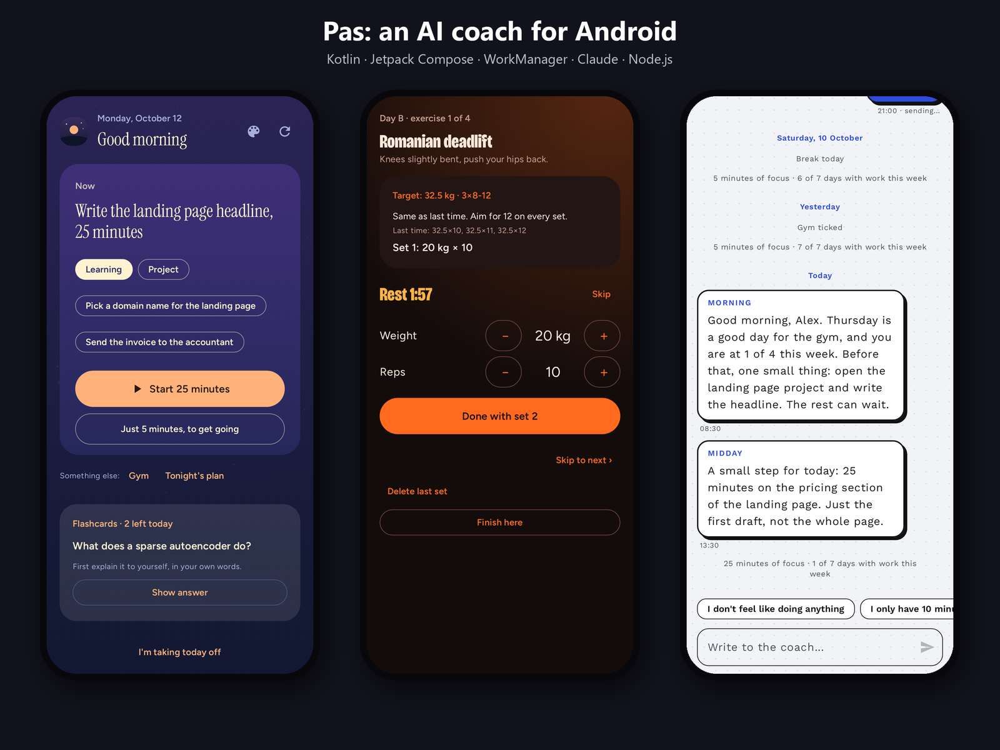
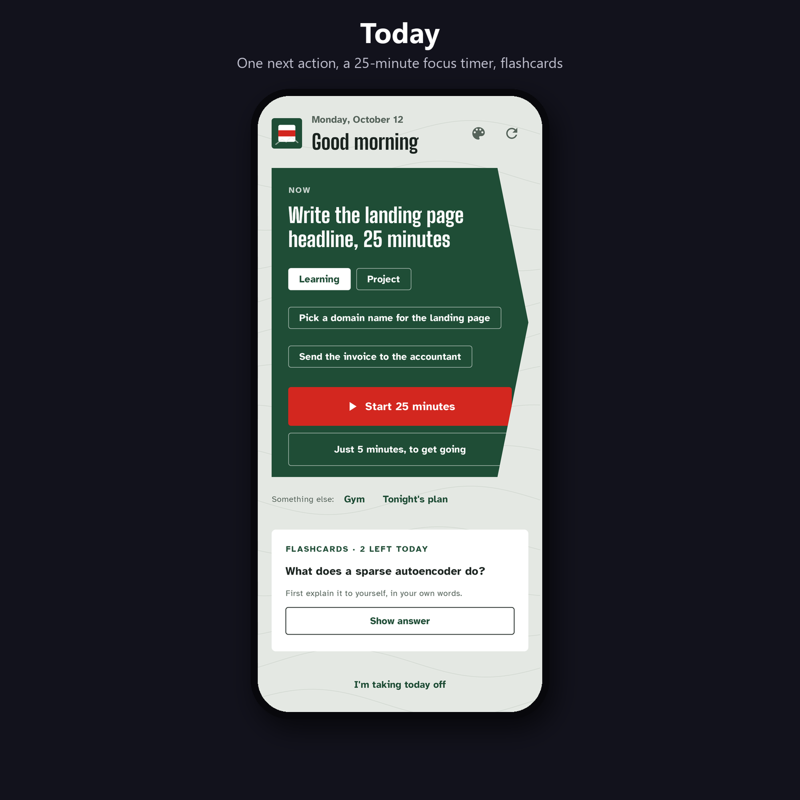
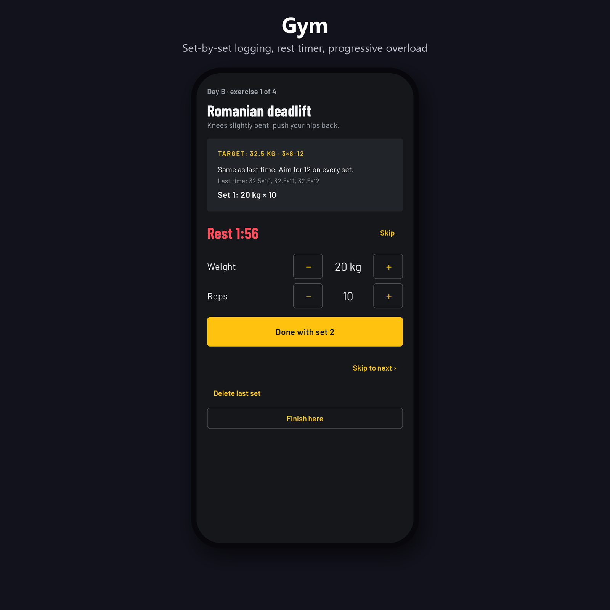
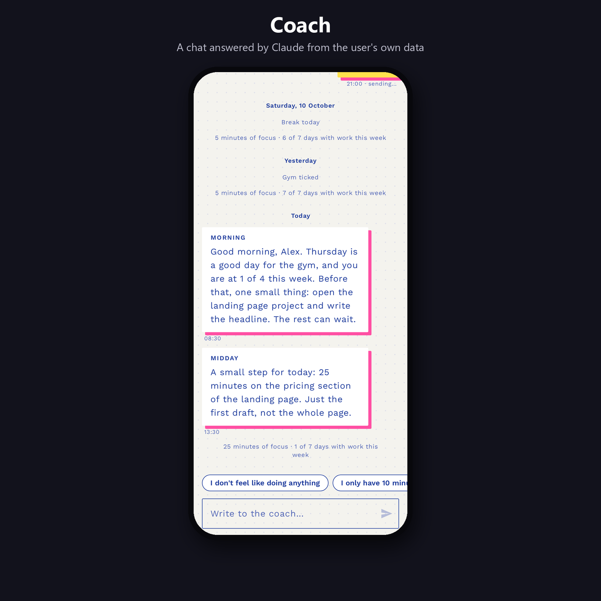
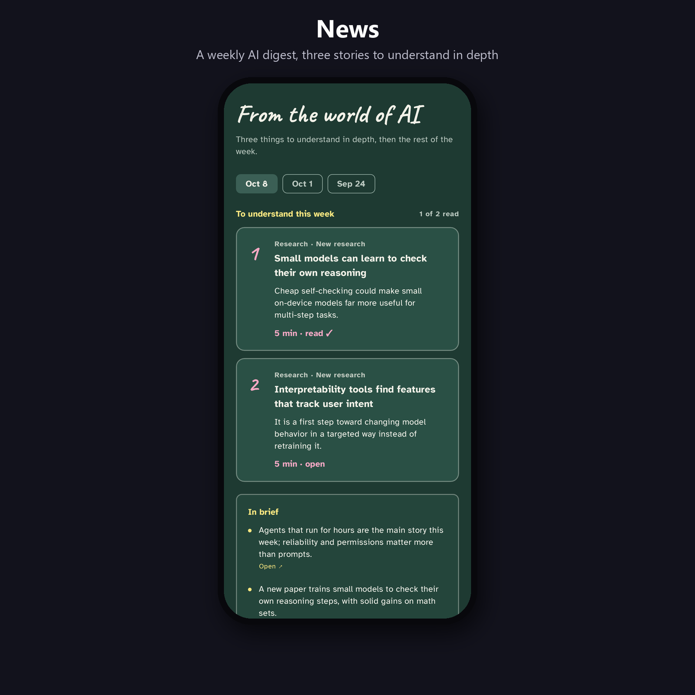
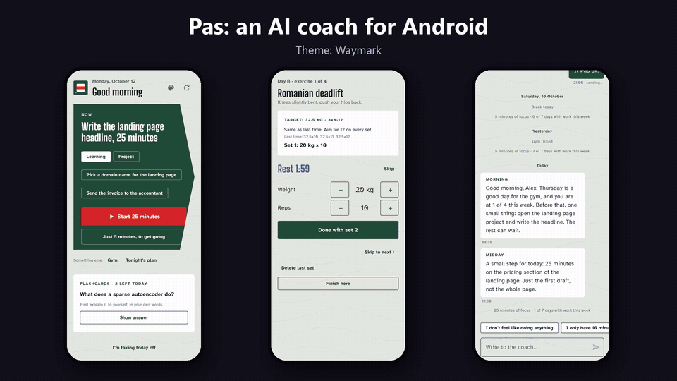
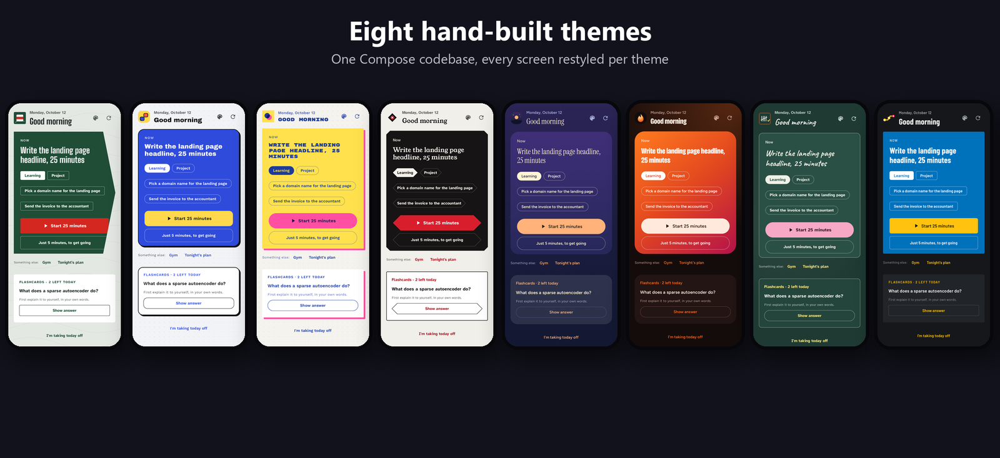

# Pas

An Android app that coaches one person through the day: one next action, a 25-minute focus timer, a gym tracker with progressive overload, and a chat with a coach written by Claude from the user's own data.



Built with **Kotlin, Jetpack Compose, WorkManager and kotlinx.serialization** on the phone, and **Node.js scripts that run Claude headless** on a PC. There is no backend server: phone and PC exchange JSON files through a private GitHub repository.

## What it does

- **Today:** one card with the next thing to do, chosen by simple rules (a planned break, then the gym on gym days, then the evening plan after 15:00, otherwise 25 minutes of focus). A focus session asks "on what?", runs a timer with a notification, and ends with "What did you learn?", which the coach turns into flashcards.
- **Gym:** a full-body A/B program, 3×8-12. Sets are logged one by one with a rest timer in the notification. Weights go up after 12 reps on every set and down after two misses or a long break.
- **Coach:** a chat. Two silent messages a day (morning and midday) plus replies within a minute or two while the PC is on. The coach sees the last 14 days of check-ins, so it quotes real numbers instead of generic praise.
- **News:** a weekly AI digest, with three stories to understand in depth.
- **Screen time:** today's phone time against yesterday and the 7-day average, read with `UsageStatsManager`.
- **Widget, notifications and in-app updates:** a home-screen widget with the day's focus, notification actions ("▶ 25 min", "Just 5 min"), and new APKs offered from GitHub releases.
- **Eight themes,** each restyling every screen, not only the colours.

## Screenshots

<table>
  <tr>
    <td></td>
    <td></td>
  </tr>
  <tr>
    <td></td>
    <td></td>
  </tr>
</table>





## How it works

```
 Phone (Kotlin)                      GitHub repo (private)                PC (Node.js)
 ─────────────                       ─────────────────────                ────────────
 SyncWorker, every 15 min  ──────▶   checkins.json   ──────────────────▶  chat.mjs   (polls every 15 s)
                           ◀──────   messages.json   ◀──────────────────  send.mjs   (08:30, 13:30)
                           ◀──────   board.json      ◀──────────────────  board.mjs  (goals, cards, digest)
                           ◀──────   releases (APK)  ◀──────────────────  publish.mjs
```

- `send.mjs` and `chat.mjs` build a prompt from `profile.md`, the recent check-ins and the conversation, call `claude -p` headless, and validate the JSON it returns before writing it.
- The phone reads and writes the repo through the GitHub contents API with a fine-grained token limited to that one repository.
- Writes on the PC go through a lock file, so the scheduled sender and the chat loop never commit over each other.

## Project layout

```
android/            Kotlin + Jetpack Compose app (minSdk 29, targetSdk 35)
  app/src/main/     screens in ui/, sync and notifications in workers
  app/src/test/     unit tests and Roborazzi screenshot tests
send.mjs            scheduled morning and midday messages
chat.mjs            answers the chat
board.mjs           goals, flashcards and the weekly digest for the phone
publish.mjs         builds the APK and publishes a release
*.example.md        sample profile and prompts
```

## Running it

1. Create a private GitHub repository for the data and set `PAS_DATA_REPO=your-user/your-repo` on the PC. Clone it into `data/`.
2. Copy `profile.example.md` to `profile.md` and edit it. The prompts fall back to `prompt.example.md` and `chat-prompt.example.md`.
3. Build the app from `android/` with Android Studio, or with `./gradlew assembleDebug`. On first launch, paste a fine-grained token with access to the data repository.
4. Schedule `node send.mjs` at 08:30 and 13:30, and keep `node chat.mjs` running. Both need the [Claude Code CLI](https://docs.anthropic.com/en/docs/claude-code) logged in.

## Tests

```
cd android
./gradlew testDebugUnitTest
```

Unit tests cover the next-action rules, the gym progression and the weekly stats. Roborazzi renders every screen in every theme on the JVM, without a device, into `app/build/screenshots/`.

## Licence

[MIT](LICENSE)
